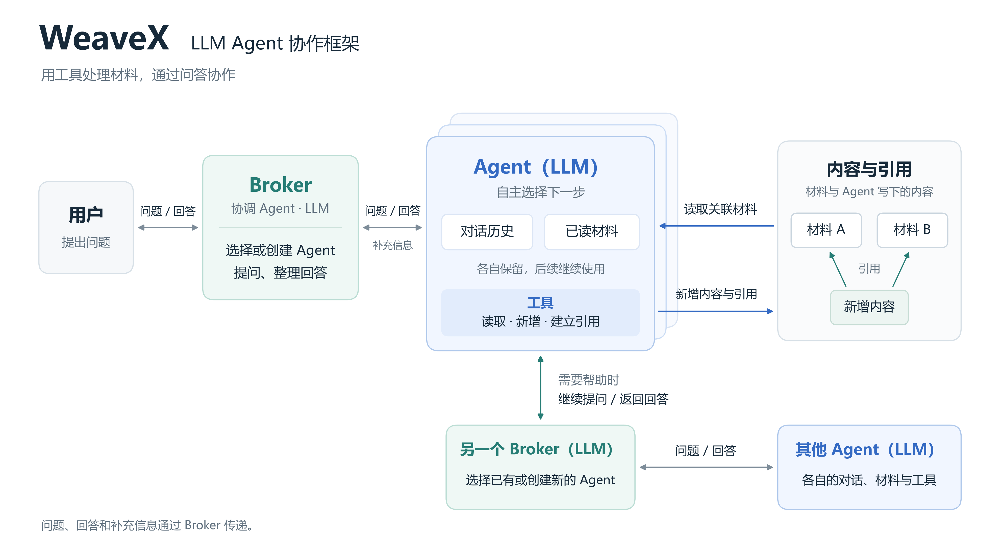
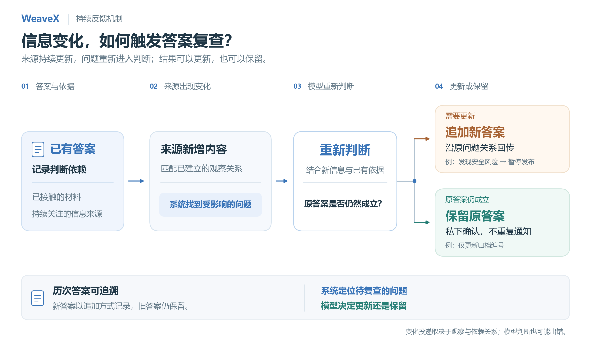

# WeaveX

**支持持续反馈的多智能体运行环境（Agent Harness）**

WeaveX 用 Python 实现模型会话、工具执行、权限检查和消息投递。每个 Agent 保留独立对话与已接触材料，由协调者 Broker 通过公开的问题和回答组织协作。系统记录回答所依赖的信息；相关来源新增内容后，受影响的问题重新进入待判断状态，由模型选择更新答案或确认原答案仍然成立。

一个具体问题：**系统已经告诉用户“可以发布”，后来出现新的安全证据，怎样复查旧判断并把更正送回用户？如果只是行政记录变化，又怎样避免重复通知？**

[快速运行](#快速运行) · [答案复查案例](docs/cases/answer-refresh.md) · [缓存诊断案例](docs/cases/cache-continuity.md) · [架构与代码导航](docs/ARCHITECTURE.md) · [实现边界](docs/LIMITATIONS.md)

## 核心能力

| 能力 | 实现内容 | 代码入口 |
| --- | --- | --- |
| 模型运行与工具执行 | 持续会话、稳定工具定义、宿主参数与权限校验、失败观察 | [runner.py](src/weavex/runner.py)、[turn_host.py](src/weavex/turn_host.py) |
| 有信息边界的协作 | 独立局部材料；Broker 依据公开问答选择、创建或复用参与者；同一 Agent 可参与多个组 | [communication.py](src/weavex/communication.py)、[coordination.py](src/weavex/coordination.py) |
| 回答的持续复查 | 记录来源依赖；观察到变化后重新交付责任；追加新答案或私下保留旧答案 | [grounding.py](src/weavex/grounding.py)、[question_frontier.py](src/weavex/question_frontier.py) |
| 增量输入与运行观察 | 对已交付材料去重；保留工具轨迹、token 用量及 provider 缓存统计 | [native_session.py](src/weavex/native_session.py)、[cost_accounting.py](src/weavex/cost_accounting.py) |

## 工作方式



Broker 本身也是 LLM Agent，理解公开结果并组织协作。业务 Agent 能读取自己取得地址所关联的材料；Broker 无法直接读取这些地址背后的内容。模型提出行动，运行环境检查是否合法并执行。架构支持多种协作方式，图中的关系不规定每次任务必须经历的步骤。

来源出现新增信息后，系统依据已有观察与判断依赖找到受影响的问题，再由模型决定更新答案或保留原结论：



具体场景和实际轨迹见[答案复查案例](docs/cases/answer-refresh.md)，内部消息如何传递见[技术时序图](docs/ARCHITECTURE.md#答案复查的消息时序)。模型判断仍可能出错，案例文档中也保留了失败记录。

## 快速运行

需要 Python 3.11+。以下命令在仓库根目录运行，不要求 Conda、GPU 或特定 shell。

**先查看已有真实模型轨迹：无需安装依赖、API key 或网络。**

```bash
python scripts/verify_evidence.py
python scripts/replay.py --case relevant
python scripts/replay.py --case irrelevant
python scripts/replay.py --case failure
```

这会检查存档哈希、复算对照结果和缓存用量，并显示保存的模型调用与公开回答。回放不会重新调用模型。

**再运行当前代码中的最小例子：**

```bash
python examples/answer_refresh.py --arm relevant
python examples/answer_refresh.py --arm irrelevant
```

默认使用明确编写的决策脚本，实际执行本仓库的会话循环、工具校验、依赖追踪和消息回传。`relevant` 会先返回 `ALLOW-DEMO`，再追加 `BLOCK-DEMO`；`irrelevant` 只保留一个公开答案，并执行一次私下保留。它验证运行机制，不计入真实模型实验成绩。

安装可选依赖、运行测试：

```bash
python -m pip install -e ".[debug,test]"
python -m pytest -q
```

[开发说明](docs/DEVELOPMENT.md)包含独立虚拟环境、真实模型运行与本地工作台入口。真实运行需要显式 `--live`、模型配置和新的输出目录；本次整理未调用在线模型。

## 已有实验观察

| 案例 | 保存的观察 | 能支持的结论 |
| --- | --- | --- |
| 答案复查，2026-08-28 | 两种路径 × 两种信息变化 × 三次运行，共 12 次主对照符合预期 | 在小型、相关性明确的场景中，变化投递、更新／保留和上游回传能够共同工作 |
| 缓存诊断，2026-09-09 | 11 次受控 API 请求；另一个三参与者回归共 29 次请求，输入 token 加权命中率 97.70% | 稳定工具定义、持续历史和增量输入可在该回归中同时工作 |

答案复查保留整批 **18 次**记录，包括额外责任测试和一次错误保留旧答案。缓存案例保留初次未闭环运行和一次被宿主拒绝的工具提案。两项案例均提供[原始证据](evidence/README.md)、统计方法和限制；这些数据不构成通用任务准确率、跨框架排名或同条件成本提升。

## 进一步阅读

- [架构与代码导航](docs/ARCHITECTURE.md)：状态由谁拥有，信息如何流动，关键测试在哪里。
- [设计取舍](docs/DESIGN.md)：信息隔离、动态协作、来源依赖、固定 schema 与宿主校验。
- [答案复查案例](docs/cases/answer-refresh.md)：条件、结果、代表轨迹和失败。
- [缓存诊断案例](docs/cases/cache-continuity.md)：原因定位、实现对应与统计复算。
- [验证记录](docs/VALIDATION.md)：当前副本实际执行的检查。
- [版本与证据来源](docs/PROVENANCE.md)：当前源码与历史实验的区别、字节哈希及未纳入范围。

当前实现是**单进程、内存态、串行调度的研究原型**。会话持续到 reset，没有跨进程持久恢复；内置世界工具操作文本内容及引用关系。更大规模协作收益和对强基线的优势仍待验证，详见[实现边界](docs/LIMITATIONS.md)。
