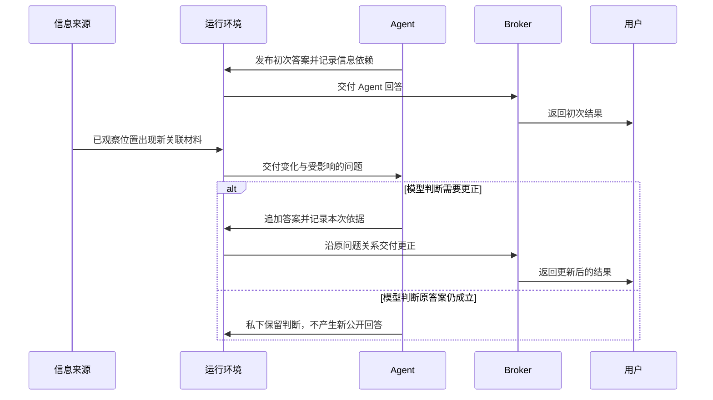

# 架构与代码导航

WeaveX 的运行环境拥有参与者身份、消息、权限、材料和实际工具效果；模型驱动器拥有模型交互循环与会话传输。模型只能通过运行环境提供的工具产生实际行动。

## 状态归属

| 状态 | 所有者 | 作用 |
| --- | --- | --- |
| Agent / Broker 身份、能力、问题预算 | [actor.py](../src/weavex/actor.py) | 创建参与者并维护每个问题的操作额度 |
| 问题、回答、补充消息与返回关系 | [inquiry.py](../src/weavex/inquiry.py)、[communication.py](../src/weavex/communication.py) | 保存不可变公开消息，检查通讯资格 |
| 文本节点与引用 | [world.py](../src/weavex/world.py) | 保存具有稳定身份的内容；只新增 |
| 某个 Agent 已接触的材料 | [local_world.py](../src/weavex/local_world.py) | 决定材料可见性，保留接触历史 |
| 已观察的引用方向 | [neighborhood.py](../src/weavex/neighborhood.py) | 匹配新增引用应交付给哪些参与者 |
| 回答的来源依赖 | [grounding.py](../src/weavex/grounding.py) | 连接材料、观察与先前判断，允许跨问题复用 |
| 最新答案及未判断变化 | [question_frontier.py](../src/weavex/question_frontier.py) | 维护哪些问题需要再次判断 |
| 调度队列与状态组合 | [runtime.py](../src/weavex/runtime.py) | 逐个处理消息或局部变化 |
| 模型会话与交付游标 | [runner.py](../src/weavex/runner.py)、[native_session.py](../src/weavex/native_session.py) | 保留对话，对已交付材料作增量投影 |
| provider 传输字段 | [provider.py](../src/weavex/provider.py) | 构建 API 请求，保留 provider 所需的私有历史 |

## 两类参与者

| | Agent | Broker |
| --- | --- | --- |
| 主要可见信息 | 自己已取得的材料、自己的历史、参与的问答 | 自己的历史、公开问答、成员与协调关系 |
| 内置能力 | 沿引用读取，新增文本或引用，提问、回答 | 选择或创建参与者，交付问题，整理公开结果 |
| 材料地址 | 在已取得的范围内读取 | 持有或按权限转交地址，不能直接读取底层材料 |

两者共用执行循环；可见信息、指令与能力不同。各自的私有历史不会自动广播。新建 Agent 不继承另一个 Agent 的经历；复用已有 Agent 会保留它在当前运行期间的经历。

同一个 Agent 可以参与多个 Broker 的组。Agent 可在已有组内提问，也可通过新 Broker 发起协作；当前没有 Agent–Agent 或 Broker–Broker 直接消息通道。候选来源与入组有明确限制，不能把它描述为任意全连接网络。

## 一次模型活动

1. `PrototypeRuntime.step()` 从队列取出一个到达事件，激活接收者。
2. `NativeTurnDriver` 保留该参与者的会话，调用模型取得工具提案。
3. 每轮先通过 `receive_input` 取得当前责任和新增信息。
4. `ActorTurnHost.execute()` 校验参数结构、当前责任、权限与额度，执行后返回成功或失败观察。
5. 模型可继续行动或 `yield_turn`。该参与者结束本轮后，队列再处理其他事件。

步骤 3 的输入门属于协议时序；后续是否读取、写入、求助、回答或继续等待由模型决定。创建参与者不会自动替它执行任务。到达事件不等于一条固定业务工作流。

## 答案复查

Agent 读取某个方向的邻域后，系统保存观察关系。回答时，Agent 可将观察、材料或先前判断写入 `grounding_inputs`。后续新增引用匹配观察关系时，变化进入 Agent 的局部信息；依赖图找到受影响的问题，让它重新进入待判断状态。

- `answer_question` 追加新的公开答案，保留旧答案。下游回答可沿原问题关系触发 Broker 的复查。
- `retain_answer` 记录私有的新判断，清除已判断的变化，不产生公开消息。
- `yield_turn` 仅结束本轮，不表示问题已解决，也不清除未判断变化。

每次回答或保留都建立新的依据根。需要继续依赖先前观察时，模型必须显式继承对应 observation 或 prior grounding；宿主不替模型认定依据充分。

### 答案复查的消息时序

下图展开首页机制图中的消息关系。更新答案沿原问题关系返回；私下保留判断不产生新的公开回答。这是一条示例路径，不规定所有任务的行动顺序。

## 工具定义与动态权限

[tool_schema.py](../src/weavex/tool_schema.py)根据参与者的配置生成稳定工具结构，不随具体问题 ID、材料 ID 或余额变化而重写 schema。动态资格由[tool_surface.py](../src/weavex/tool_surface.py)、[turn_host.py](../src/weavex/turn_host.py)和[capabilities.py](../src/weavex/capabilities.py)校验。

固定结构不等于放宽权限。非法地址、越权来源或已结束责任仍会被拒绝，失败观察返回模型以便它修正。

## 推荐阅读顺序

| 想核查什么 | 实现 | 对应测试 |
| --- | --- | --- |
| 运行循环与工具边界 | `runner.py`、`turn_host.py` | [test_native_turn.py](../tests/test_native_turn.py)、[test_host_tools.py](../tests/test_host_tools.py) |
| 信息隔离、创建与协作 | `actor.py`、`communication.py`、`coordination.py` | [test_coordination.py](../tests/test_coordination.py)、[test_closed_loop.py](../tests/test_closed_loop.py) |
| 来源改变如何影响旧问题 | `grounding.py`、`question_frontier.py`、`runtime.py` | [test_grounding.py](../tests/test_grounding.py)、[test_question_frontier.py](../tests/test_question_frontier.py) |
| 材料增量与稳定接口 | `native_session.py`、`tool_schema.py` | [test_native_projection.py](../tests/test_native_projection.py)、[test_stable_tools.py](../tests/test_stable_tools.py) |

完整源码保留原有模块，包括初始化适配器和调试工作台。理解核心链条不需要先阅读所有模块。运行时提示位于[prompts](../src/weavex/prompts/)，它们属于模型行为输入。
