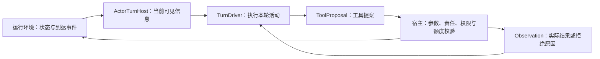

# 执行后端与运行环境的边界

WeaveX 将“怎样驱动模型的一轮活动”和“行动实际改变什么”分开。运行环境拥有参与者、问题责任、权限、预算、材料与消息；驱动器拥有执行循环及会话历史。更换驱动器不意味着可以绕开宿主工具检查。



## 接口

| 接口 | 职责 | 实现入口 |
| --- | --- | --- |
| `TurnDriver.activate(host)` | 驱动一个参与者的一次活动 | [execution.py](../src/weavex/execution.py) |
| `dialogue_for(actor_id)` / `reset()` | 供观察与清除驱动器拥有的会话 | [runner.py](../src/weavex/runner.py) |
| `host.situation()` / `host.tool_schemas()` | 获得角色相对信息与工具协议 | [turn_host.py](../src/weavex/turn_host.py) |
| `host.execute(ToolProposal)` | 校验后执行实际效果，返回结果及是否结束本轮 | [tool_surface.py](../src/weavex/tool_surface.py)、[capabilities.py](../src/weavex/capabilities.py) |

初始化时，`build_default_runtime(model=...)` 使用默认原生驱动器；也可以传 `turn_driver=...`，两者必须且只能选一个。

## 现有测试具体证明了什么

[test_turn_driver.py](../tests/test_turn_driver.py)中有两个检查：

1. 一个记录型驱动器接收实际激活，Runtime 从它取得对话，并在 reset 时调用其清理。角色相对状态对象不额外拥有该驱动器的对话。
2. `_DirectProposalTurnDriver` 不依赖默认 `ModelPort`，通过同一 `ActorTurnHost` 完成接收输入、创建参与者、交付问题、返回答案和让出活动的闭环。

```bash
python -m pytest -q tests/test_turn_driver.py
```

这是第二种驱动器对宿主协议的一致性验证；它使用确定性提案，不是第二种真实模型服务的兼容性成绩。

参数与动态资格检查另由 [test_host_tools.py](../tests/test_host_tools.py)、[test_stable_tools.py](../tests/test_stable_tools.py)覆盖。保持工具 schema 稳定不会放宽权限，模型收到成功／失败观察后仍需选择后续行动。

## 设计价值与当前边界

这使模型传输、循环策略与宿主效果可以分别测试。替换或试验执行后端时，材料可见性、消息规则与预算仍有统一执行位置；错误定位也能区分模型提案、传输和宿主拒绝。

当前只验证了这些接口与原生适配器，没有通用插件热替换、存活会话迁移、跨进程恢复或“兼容所有模型”的承诺。端点的 thinking 与工具调用协议仍需单独适配。
