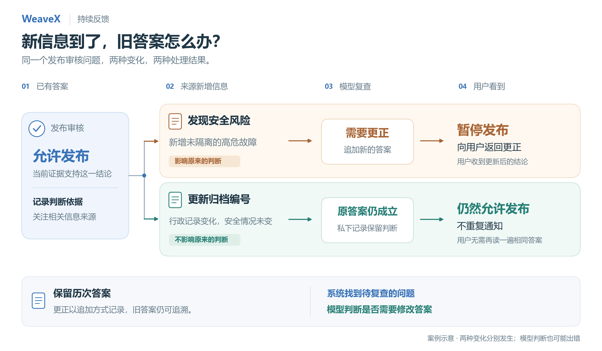

# 案例：新信息到达后复查已有答案

## 要解决的问题

一个发布审核问题已得到“允许发布”的答案。随后，同一信息来源出现新材料。系统需要让承担旧判断的 Agent 接触变化，并在必要时把更正返回用户，同时保留旧答案。

这里检查两个分支：新增安全风险应导致更正；只改变行政归档的信息应保留旧答案并避免重复公开回答。



图中两种变化分别发生，用于说明两个对照条件；具体实验结果与限制如下。

## 历史实验条件

- 日期：2026-08-28；记录中的模型标识：`deepseek-v4-flash`，thinking 模式。
- 主矩阵：Agent 内部判断、Agent→Broker→用户两种路径；各含相关／无关变化两组，每组 3 次，共 12 次。
- 世界材料含随机证据标记。初始 `ALLOW-*`、后续 `BLOCK-*` 或 `DOC-*` 用于检查结果是否对应实际材料。
- 实验脚本提供世界、角色、问题、额度和变化，控制队列与分阶段执行；模型选择更新、保留等行动。固定参与者和返回链不计为模型自主组建协作的成果。
- 相关材料明确写出新的安全风险；无关材料明确说明只影响归档。因此相关性判断较容易。
- 原报告说明早期 smoke 的队列与预算夹具曾被修正，最终文件覆盖相应运行；被覆盖的 smoke 不包含在这 18 份记录中。不能把这一批称为未经调试的预注册实验。

[原始实验约定](../../evidence/answer-refresh/original/charter.md) · [原始报告](../../evidence/answer-refresh/original/report.md) · [原脚本](../../evidence/answer-refresh/original/run.py)

## 保存的结果

| 路径 | 新增安全证据 | 行政记录变化 |
| --- | --- | --- |
| Agent 内部复查 | 3/3 追加原问题的新答案 | 3/3 私下保留，没有重复公开答案 |
| Agent → Broker → 用户 | 3/3 更正返回用户 | 3/3 不增加用户答复 |

核验工具从逐次 JSON 重新检查答案数、返回的原问题 ID、证据标记、`answer_question`／`retain_answer` 提案，以及 Broker 是否产生后续处理；同时检查与保存的判定字段一致。它没有引入另一个 LLM 裁判。

```bash
python scripts/verify_evidence.py
python scripts/replay.py --case relevant
python scripts/replay.py --case irrelevant
```

### 一条更新轨迹

[原始记录](../../evidence/answer-refresh/02-broker-human/relevant-1.json)中，用户先收到 `ALLOW-A7CE084F3B`。新增材料包含未隔离的高危故障与 `BLOCK-A7CE084F3B`，Agent 追加新答案，Broker 再向同一个用户问题追加 `BLOCK` 答案。原用户答案 `act-4` 与更新答案 `act-8` 的 `reply_to` 都是 `act-1`。

### 一条保留轨迹

[原始记录](../../evidence/answer-refresh/02-broker-human/irrelevant-1.json)中，行政归档更新带来 `DOC-6F365D1709`。Agent 调用 `retain_answer`，没有新增公开答案，Broker 没有后续事件，用户只保留原来的一个答案。

## 失败与解释边界

整批还有 3 次旧问题与新问题竞争、3 次操作能力耗尽的扩展运行，故总数为 18。

[能力耗尽的第三次运行](../../evidence/answer-refresh/04-exhausted-gap/run-3.json)中，决定性证据仍位于不可读邻域。模型没有伪造隐藏标记，却错误调用 `retain_answer`，使待判断变化消失。系统维护了模型选择的机械效果，但该选择的语义充分性有问题。

这说明“让变化重新进入待判断状态”和“模型作出正确的新判断”是两个层面。当前运行环境没有通用的充分性裁判。该反例与全部主对照一起保留；主矩阵的 12/12 不能推广成总体正确率，也不能支持多 Agent 优于单 Agent 的结论。

## 当前版本的可运行示例

```bash
python examples/answer_refresh.py --arm relevant
python examples/answer_refresh.py --arm irrelevant
```

这两个例子使用当前源码与显式决策脚本，在真实 Runtime 中执行原问题、读取观察、记录依赖、外部新增引用、复查与回传。参与者预先声明，外部脚本注入变化。它们不恢复 8 月的运行状态，不计入上述 12 次真实模型结果。

同一入口提供 `--live` 模式：将决策脚本换为配置的真实模型，仍使用固定夹具，并把结果另存到 `output/`。这是新实验入口，尚未在本次整理中执行；成功与否均应按新版本另行报告。详见[开发说明](../DEVELOPMENT.md#真实模型运行)。
