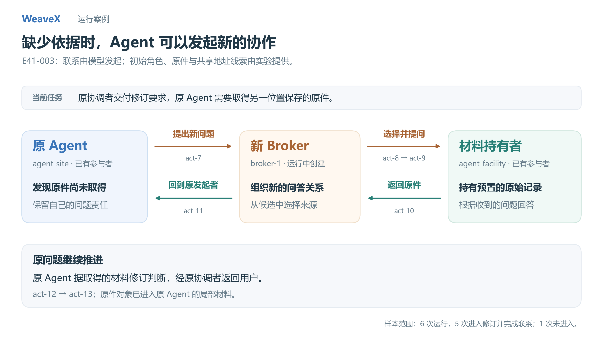

# 案例：Agent 因信息缺口发起新的协作

## 问题

承担修订任务的 Agent 需要一份原始访谈记录，但当前材料中没有原文。运行环境允许它提出新的完整问题，通过新建的 Broker 联系已有材料持有者，再带着结果继续原问题。

本案例来自 2026-09-18 的 E41 六次真实模型运行。它展示的是给定环境中的动态联系与结果回传；来源并非从开放互联网任意发现。



## 哪些条件预先给定

- 初始有审查办公室与设施方等参与者，设施方持有原始访谈记录；初始角色、材料、授权与候选规则由实验提供。
- 先要求办公室作出明确的是／否认定。若出现无依据的否定，环境按预定分支提供后果与调查问题，要求以原件为依据修订。
- 调查材料说明原件的保管者，以及它与已有事件记录的联系，但不直接交付原件全文。
- 共享对象身份与关联线索使持有原件的 Agent 能进入候选。这是有利的预置条件，不能省略。

模型实际选择了外问、建群、向来源提问和处理返回材料。外层阶段注入、后果与模型评审由实验装置提供；不是系统自主设计出的业务世界。

## 六次运行全部保留

| 运行 | 是否进入后果修订分支 | 新协作及原件回流 | 历史结果标签 |
| --- | --- | --- | --- |
| 001 | 否 | 未发生 | `precautionary_finding_without_record` |
| 002 | 是 | 已核查 | `error_corrected_with_record` |
| 003 | 是 | 已核查 | `error_corrected_with_record` |
| 004 | 是 | 已核查 | `error_corrected_with_record` |
| 005 | 是 | 已核查 | `error_corrected_with_record` |
| 006 | 是 | 已核查 | `error_corrected_with_record` |

统计口径是 **6 次运行中的 5 次进入修订并完成该链**。001 没有进入这条路径，不能计成动态协作成功；另外五次是错误之后的取证与修订，也不能称为事故预防成功。

结果标签来自原实验判定。新增离线核验独立检查模型提案、新 Broker、实际成员关系、公开消息的返回指针，以及原件对象是否进入原问题承担者的局部材料；它不重新作语义评审。

## 一条代表轨迹：003

| 记录 | 实际发生的行为 |
| --- | --- |
| `act-5 → act-6` | 外部修订要求经原 Broker 交给 `agent-site` |
| trace `seq=147` | `agent-site` 选择 `ask_external_question`，提出取得原件的独立问题 |
| `act-7` / trace `seq=148` | 新问题进入运行中新建的 `broker-1` |
| `act-8` | `broker-1` 形成包含已有 `agent-facility` 的组 |
| `act-9 → act-10` | 向设施方提问，设施方返回原件内容 |
| `act-11` | 新 Broker 沿 `act-7` 返回给原发起者 `agent-site` |
| `act-12 → act-13` | 原 Agent 继续修订，结果经原 Broker 返回用户 |

核验还确认：访谈记录的同一对象身份进入了 `agent-site` 的局部材料。这里保留原始 ID 是为了可以逐条查证；代码没有靠这张表预设模型行动。

[003 公开消息](../../evidence/extended/dynamic-collaboration/e41-live-anchor-003/public-acts.json) · [003 原结果](../../evidence/extended/dynamic-collaboration/e41-live-anchor-003/result.json) · [六次结构核验](../../evidence/extended/audit-summary.json)

```bash
python scripts/replay.py --case collaboration
python scripts/replay.py --case collaboration --full
python scripts/verify_evidence.py
```

## 能说明什么

Agent 可以在承担原问题时提出新的信息需求，新关系获得的答案可以返回发起者，由它继续处理原责任。原入口不必事先写出这一条下游调用路径。

这项能力有当前源码和机制测试支撑：[coordination.py](../../src/weavex/coordination.py)、[test_coordination.py](../../tests/test_coordination.py)。它不保证每次都能找到来源，也不构成相对强单 Agent 或中央配置的效果、成本优势。给定共享锚点、已知保管者和强修订要求，是解释本组结果的重要条件。

## 版本与复核范围

公开包保存六次运行的 manifest、原结果、公开消息、usage、压缩 core snapshot、源码哈希，以及按版本去重的冻结源码 ZIP。保存的模型标识是 `deepseek-v4-flash`。原 `interface.jsonl` 全量流未复制，也未重新调用模型。

回放读取历史记录，不将该轨迹套到当前源码执行；冻结源码仅用于查阅与哈希核验。见[工件索引](../../evidence/extended/README.md)。
