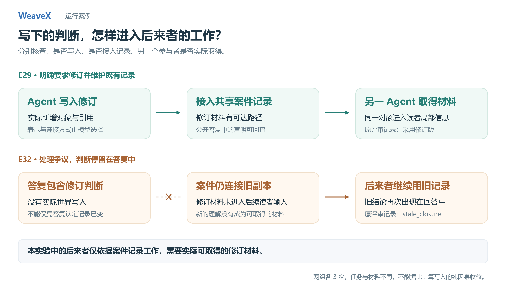

# 案例：让写下的判断成为后来者可用的材料

## 问题

一个 Agent 已经形成新的判断，另一个位置稍后只依据案件记录工作。前者需要实际写入材料、建立可达关系，后者还需要真正取得并使用它。仅在对话中说“已经修订”，并不保证后来的输入发生变化。

这里保留 E29–E32 四组、共 12 次历史开发运行。主案例 E29 包含模型实际写入和另一个读者取得材料；E30/E31 区分预置修订的可得性；E32 保留答复没有进入后续记录的反例。



## 先区分事实与评审

| 条件 | 离线重新核查的结构事实 | 保存的语义评审 |
| --- | --- | --- |
| E29，3 次 | 模型执行成功的对象／引用写入；新材料从案件出向关系可达，进入不同读者的局部材料 | 3 次标记采用修订判据 |
| E30，3 次 | 修订材料由装置预置；3 次均进入读者局部材料，无模型世界写入 | 3 次标记采用修订判据、条件 1 未闭合 |
| E31，3 次 | 旧副本条件下，修订材料未进入读者局部材料，无模型世界写入 | 3 次标记 `stale_closure` |
| E32，3 次 | 处理争议后的运行无成功世界写入；后续读者仍未取得修订材料 | 后续 3 次标记 `stale_closure` |

右列来自原实验的模型评审，保留原文，不当作新的独立正确性证明。左列由工具效果、最终对象图和参与者实际局部材料复算。原指标中的 `new_objects` 可能混入装置创建的对象，因此本核验只计 `world_add_object` / `world_add_reference` 的成功工具效果，不照搬该计数。

这四组属于逐步开发的不同条件，不能合并为一个成功率，也不是架构间公平基线。E29 与 E32 的任务措辞、案件和材料不同，不能把它们的差异全部归因于是否写入。

## 主案例：E29 的实际写入与后续取得

初始问题明确要求“修订同类案件判据，并处理既有案件对旧版的使用”，还要求其他位置能依据记录复现。新增规则方向也由任务给出。因此，这是明确维护责任下，模型选择材料内容与连接方式的案例；不是没有提示的自发知识维护。

以 002 为例：

1. `agent-records` 调用 `world_add_object`，写下修订判据；随后成功建立指向修订版的引用。
2. 原 Broker 的 `act-4` 向用户报告修订及链接位置。
3. 装置另行提出 R-9 核对问题。另一个组中的 `agent-1` 读取案件记录。
4. 新建判据的同一对象身份实际进入该读者局部材料；其公开回答明确引用修订版并应用新增条款，最终由 `act-8` 返回用户。

这个案例强调的是写入、连接、跨参与者取得和采用。后续核对问题及“未接触其他案件材料”的要求来自脚本；不能把新建读者也算成无条件自主组织。对具体工程判据是否充分，仍应分别审阅记录和原模型评审。

[002 公开消息](../../evidence/extended/shared-records/e29-live-author-copy-002/public-acts.json) · [002 原结果](../../evidence/extended/shared-records/e29-live-author-copy-002/result.json)

```bash
python scripts/replay.py --case shared-record
```

## 可得性探针：E30 / E31

场景给出了“核验之后又更换紧固件”的明确时序问题。E30 的读者可以取得预置修订判据，记录中的回答据此要求重做核验；E31 使用旧副本，读者没有取得该修订，保存的评审将三次结果标为沿用旧闭合结论。

这里没有模型写出修订材料的行为。它说明后续输入所能取得的版本会影响判断，不证明“共享身份自动传播所有更新”，也不证明版本化副本必然不可用。

```bash
python scripts/replay.py --case reachable-revision
python scripts/replay.py --case isolated-copy
```

## 反例：E32 的答复没有进入记录

办公室接到争议后，在答复中采用了新判据并提出重新核验要求。但三次运行都没有成功的世界写入。后来仅依案件记录工作的读者仍未取得新判据，原评审均标记为 `stale_closure`。

答复中的修订解释不能替代材料交付事实；本例需要分别查看办公室答复、写入轨迹和后续读者输入。公开目录保留三次结果，回放默认选择 001。

[001 公开消息](../../evidence/extended/shared-records/e32-live-dispute-001/public-acts.json) · [001 原结果](../../evidence/extended/shared-records/e32-live-dispute-001/result.json)

```bash
python scripts/replay.py --case stale-record
python scripts/verify_extended.py
```

## 与当前机制的联系

文本对象与引用允许 Agent 将判断写成其他位置可取得的材料；实际可见性由读取或地址交付决定，后续复查还需要建立观察与判断依赖。写入本身不保证别人读取、采纳或正确理解，也不保证写入内容真实。

当前代码还支持同一个 Agent 在多个问题间组合来源依赖：一个观察可以影响两个问题的复查，已有[专项测试](../../tests/test_grounding.py)。这与上述历史案例是不同层次的证据，不把当前测试轨迹计入历史模型成绩。

## 版本与工件

E29–E32 均为 2026-09-18 的记录，模型标识保留原值。每组保存全部三次 manifest、结果、公开消息、usage、压缩快照及源码哈希，另保存四套冻结源码。回放不调用模型。见[完整工件索引](../../evidence/extended/README.md)和[离线审计结果](../../evidence/extended/audit-summary.json)。
